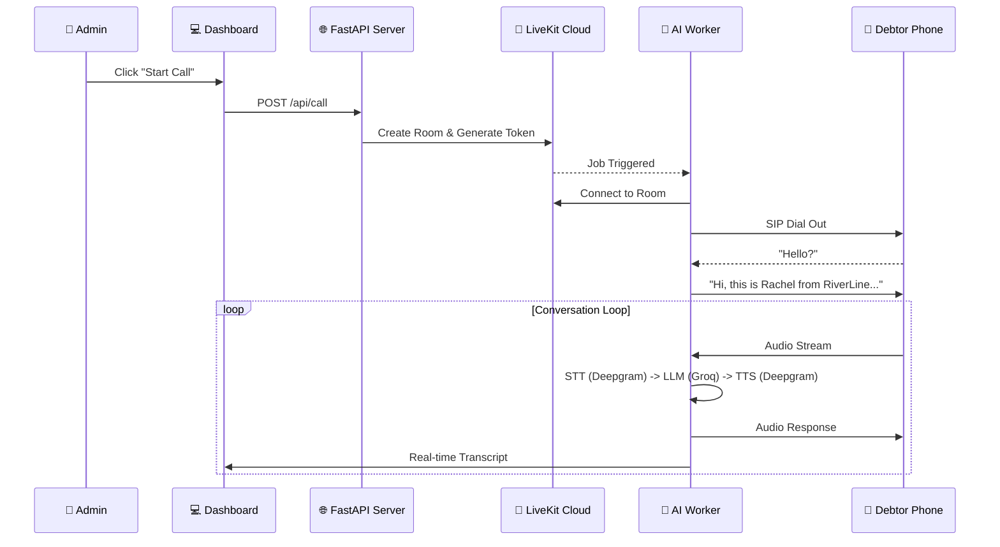

<div align="center">

# 🎙️ Vaani (Odeon)
### Intelligent Debt Collection Command Center

[](https://www.python.org/)
[](https://react.dev/)
[](https://livekit.io/)
[](LICENSE)
[]()

**Vaani** is a production-grade, voice-native AI platform that redefines debt recovery. By fusing **LiveKit's** real-time transport with **Groq's** lightning-fast inference and **Deepgram's** voice intelligence, Vaani creates an autonomous negotiator that is ethical, compliant, and startlingly human.

[features](#-capabilities) • [architecture](#-technical-architecture) • [call-flow](#-how-it-works) • [installation](#-installation--setup) • [usage](#-usage-guide)

</div>

---

## 🌟 Capabilities

### 🧠 **Conversational Voice Intelligence**
*   **Sub-500ms Latency:** Powered by **Groq (Llama 3)** and **Deepgram Nova-2**, providing instant responses that feel like a natural conversation.
*   **Full Duplex:** Debtors can interrupt the agent at any time, just like in a real human call.
*   **Dynamic Personas:**
    *   *Rachel:* Empathetic and patient (Good for hardship cases).
    *   *Orion:* Firm and direct (Good for strategic defaulters).

### 🕵️ **"Sherlock" Risk Engine**
Vaani doesn't just talk; it **analyzes**. The integrated "Sherlock" engine monitors every second of the call for compliance:
*   **FDCPA Guardrails:** Instantly flags **Bankruptcy**, **Attorney Representation**, or **Cease & Desist** triggers.
*   **Matrix Profiling:** Classifies debtors into strategic quadrants (e.g., *Hardship Case* vs *Strategic Defaulter*).
*   **Live Tags:** Autonomously tags calls as *Promise to Pay (PTP)*, *Refusal*, or *Dispute*.

### 💻 **The Command Center**
*   **Dark Mode CLI Interface:** Watch the live transcript unfold in a cinematic, hacker-style terminal.
*   **Real-time Visualization:** Risk badges pop up instantly as the AI detects intent.
*   **Analytics:** Track recovery rates and risk scores across thousands of calls.

---

## 🏗️ Technical Architecture

Vaani operates on a high-performance, modular 3-tier architecture.

| Component | Technology Stack | Purpose |
| :--- | :--- | :--- |
| **Frontend** | React 18, Vite, Tailwind CSS | The "Mission Control" dashboard for dispatch and monitoring. |
| **Backend API** | Python, FastAPI | Orchestrates calls, manages `sip_handler`, and serves API endpoints. |
| **Voice Agent** | LiveKit Agents, Groq, Deepgram | The "Brain" that connects to the audio stream and generates speech. |

---

## 🧩 How It Works



---

## 🚀 Installation & Setup

### Prerequisites
*   **Python 3.10+** (Essential - 3.13 is NOT supported yet)
*   **Node.js 18+**
*   **LiveKit Cloud Account**
*   **API Keys:** Groq, Deepgram, LiveKit

### 1. Clone the Repository
```bash
git clone https://github.com/vasu-devs/Vaani.git
cd Vaani
```

### 2. Configure Environment
Create a `.env.local` file in the `backend/` directory (or root, the runner handles it):

```env
# LiveKit Config
LIVEKIT_URL=wss://your-project.livekit.cloud
LIVEKIT_API_KEY=API_...
LIVEKIT_API_SECRET=Secret_...

# AI Models
GROQ_API_KEY=gsk_...
DEEPGRAM_API_KEY=...

# Telephony (Optional)
SIP_OUTBOUND_TRUNK_ID=ST_...
```

### 3. Quick Start (Recommended)
We provide a unified runner to handle everything.

```bash
# 1. Install Backend Dependencies
# Note: Ensure you are using Python 3.10/3.11/3.12
pip install -r backend/requirements.txt

# 2. Install Frontend Dependencies
cd frontend
npm install
cd ..

# 3. RUN!
python dev.py
```

This will launch:
*   **API Server:** http://localhost:8001
*   **Frontend:** http://localhost:5173
*   **Agent Worker:** Background process

### 4. 🚀 Deployment (DigitalOcean / Railway / Render)

We have included `Dockerfile`s to make deployment easy.

#### DigitalOcean App Platform (Recommended)
1.  Fork this repo.
2.  Create a new **App** in DigitalOcean.
3.  **Service 1 (API):** Select `backend/Dockerfile`. Port `8000`. 
    *   Command: `python -m uvicorn run_server:app --host 0.0.0.0 --port 8000`
4.  **Service 2 (Agent):** Add a component. Select `backend/Dockerfile`. Type: **Worker**.
    *   Command: `python run_agent.py start`
5.  **Service 3 (Frontend):** Add a component. Select `frontend/Dockerfile`. Port `80`.
6.  **Environment Variables:** Copy your `.env.local` to the App-Level Environment Variables.

#### Local Production Test
To verify the production build on your machine:
```bash
docker compose -f docker-compose.prod.yml up --build
```

---

## 📂 Project Structure

```text
Vaani/
├── backend/                # Python Server & Agent Code
│   ├── app/                # Main Application Logic
│   │   ├── api/            # FastAPI Routes
│   │   ├── services/       # Business Logic (SIP, Agents)
│   │   └── core/           # Config & Utils
│   ├── run_agent.py        # Worker Entrypoint
│   ├── run_server.py       # API Entrypoint
│   └── requirements.txt    # Python Deps
│
├── frontend/               # React Application
│   ├── src/
│   │   ├── components/     # UI Components (Sidebar, Terminal...)
│   │   └── App.jsx         # Main View
│   └── package.json        # JS Deps
│
└── dev.py                  # Unified Development Runner
```

---

## ⚠️ Troubleshooting

| Issue | Solution |
| :--- | :--- |
| **ImportError: cannot import name 'api' from 'livekit'** | Ensure you have installed `livekit-api` and NOT `livekit-server-sdk`. Check `backend/requirements.txt`. |
| **Agent Not Joining** | Check `.env.local` credentials. Run `python backend/run_agent.py dev` manually to see logs. |
| **No Audio** | Verify you have `livekit-plugins-deepgram` and `livekit-plugins-groq` installed. |
| **Python Version Error** | LiveKit SDK currently requires Python < 3.13. Use Python 3.10, 3.11, or 3.12. |

---

## 🤝 Contributing

Contributions are what make the open source community such an amazing place to learn, inspire, and create. Any contributions you make are **greatly appreciated**.

1.  Fork the Project
2.  Create your Feature Branch (`git checkout -b feature/AmazingFeature`)
3.  Commit your Changes (`git commit -m 'Add some AmazingFeature'`)
4.  Push to the Branch (`git push origin feature/AmazingFeature`)
5.  Open a Pull Request

---

## 📄 License

Distributed under the MIT License. See `LICENSE` for more information.

---

<p align="center">
  Built with 🖤 by <a href="https://github.com/vasu-devs">Vasudev</a>.
</p>
